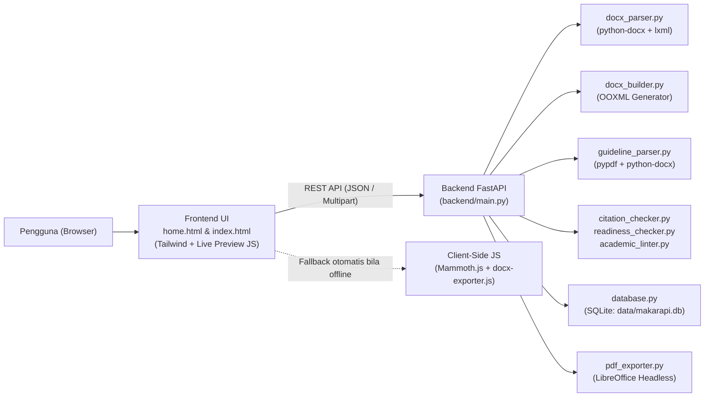

# MakaRapi — Sistem Perapihan & Format Makalah Akademik Berbasis Hybrid (Web JS + Python FastAPI)

**MakaRapi** adalah aplikasi web untuk merapikan, mengaudit, dan memformat naskah makalah/skripsi (`.docx`) secara otomatis sesuai pedoman tata tulis akademik Indonesia. Sistem dibangun dengan arsitektur **Hybrid**: antarmuka interaktif & pratinjau kertas *real-time* di browser (HTML/Tailwind/JS), dipadukan dengan backend **Python (FastAPI + `python-docx` + `lxml` + SQLite)** untuk pemrosesan OOXML `.docx` yang presisi — lengkap dengan *graceful fallback* ke mode lokal browser bila server offline.

---

## Fitur Utama

1. **Impor & Ekstraksi Terstruktur `.docx`**
   - Membaca isi dokumen `.docx` beserta urutan paragraf, penomoran otomatis Word (`word/numbering.xml`), huruf miring (*italic* istilah asing), tabel, dan gambar tertanam (`word/media/*`).
   - Memisahkan otomatis Judul Cover, **Abstrak** (+ Kata Kunci), **Kata Pengantar**, isi **BAB I–III**, dan **Daftar Pustaka**.
   - Validasi *magic bytes* ZIP (`PK\x03\x04`) untuk menolak berkas `.docx` tidak valid.
2. **Ekspor `.docx` OOXML Asli (Bukan HTML-`.doc`)**
   - Membuka dan menyimpan ulang (`Ctrl+S`) di Microsoft Word tetap pada **Print Layout** (`<w:view w:val="print"/>`, `compatibilityMode="15"`, bahasa `id-ID`).
   - Style asli Word: `Heading 1` (BAB & halaman depan), `Heading 2` (Sub-bab), `Heading 3` (Sub-sub-bab), `Caption` (`SEQ Tabel`/`SEQ Gambar`), serta field **Daftar Isi (`TOC 1–3`)**, **Daftar Tabel**, dan **Daftar Gambar** berbasis *right-aligned dotted tab stop* (tanpa tabel).
   - **Penomoran otomatis asli Word (`word/numbering.xml`)** untuk daftar bernomor/bullet maupun sub-bab (`A., B., C.` dan `1.1, 1.2, 1.1.1`) yang otomatis restart di tiap BAB.
   - Section break asli (Cover tanpa nomor → Halaman awal Romawi kecil `i, ii, ...` → Isi BAB angka Arab `1, 2, ...` dengan aturan *Different First Page*).
3. **Ekspor PDF Native (Opsional LibreOffice Headless)**
   - Mengonversi `.docx` ke `.pdf` secara native via `soffice --headless` bila LibreOffice terpasang, dengan fallback otomatis ke mode cetak PDF browser.
4. **Pedoman Kampus & Database SQLite (CRUD)**
   - Ekstraksi aturan tata tulis otomatis dari file pedoman (`.pdf`, `.docx`, `.txt`, `.md`) atau teks tempelan.
   - Penyimpanan persisten profil pedoman kampus pada database SQLite (`data/makarapi.db`).
5. **Audit Akademik Terpadu**
   - **Audit Konsistensi Sitasi ↔ Daftar Pustaka**: mendeteksi kutipan in-text yang belum tercantum di Daftar Pustaka maupun referensi yang belum pernah dikutip.
   - **Laporan Audit Kelayakan Makalah (*Readiness Report*)**: skor kelayakan (0–100%), cek kelengkapan cover, struktur BAB, referensi silang tabel/gambar, kepatuhan pedoman, dan peringatan elemen kompleks (*equation* / *footnote*), dapat diunduh sebagai `.txt`.
   - **Perapihan Tata Tulis Akademik Terpisah (1-Klik + Urungkan)**: tombol terpisah **Kata Baku** (perbaikan kata tidak baku KBBI seperti *analisa → analisis*, *resiko → risiko*, *praktek → praktik*) dan **Italic Asing** (pemiringan otomatis istilah asing akademik seperti *artificial intelligence*, *machine learning*, *chatbot*), dilengkapi tombol **Urungkan** untuk membatalkan aksi perapihan otomatis.

---

## Arsitektur Sistem Hybrid



---

## Struktur Direktori

```text
.
├── home.html                   # Halaman Menu Utama & Unggah Berkas .docx
├── index.html                  # Halaman Workbench 3-Panel (Inspektor, Editor, Pratinjau)
├── css/
│   └── style.css               # Stylesheet Editorial & Aturan @media print
├── js/
│   ├── tailwind-config.js      # Konfigurasi tema warna & tipografi
│   ├── api-client.js           # Klien API Hybrid (auto-detect FastAPI + fallback JS)
│   ├── docx-exporter.js        # Generator OOXML .docx fallback lokal (zero dependency)
│   ├── home.js                 # Logika halaman utama & handoff impor
│   └── app.js                  # Mesin editor, paginasi pratinjau, sitasi, & audit UI
├── backend/
│   ├── main.py                 # Server FastAPI + Static File Server
│   ├── docx_parser.py          # Parser .docx (teks, italic, numbering, tabel, gambar)
│   ├── docx_builder.py         # Builder .docx OOXML (python-docx + lxml)
│   ├── guideline_parser.py     # Ekstraktor berkas pedoman (.pdf/.docx/.txt/.md)
│   ├── citation_checker.py     # Audit konsistensi sitasi <-> Daftar Pustaka
│   ├── readiness_checker.py    # Audit kelayakan dokumen & generator laporan
│   ├── academic_linter.py      # Pemeriksa kata baku KBBI & auto-italic istilah asing
│   ├── pdf_exporter.py         # Konverter .docx -> .pdf via LibreOffice headless
│   └── database.py             # Layer SQLite CRUD profil pedoman kampus
├── data/
│   └── makarapi.db             # Database SQLite (terbuat otomatis saat server jalan)
├── tests/
│   ├── test_makarapi.py        # Suite unit test otomatis (unittest)
│   ├── benchmark.py            # Skrip benchmark performa & akurasi (BAB IV)
│   └── benchmark_report.csv    # Output metrik kuantitatif benchmark
├── requirements.txt            # Dependensi Python
└── run_server.bat              # Launcher 1-klik server Windows
```

---

## Spesifikasi REST API

Dokumentasi interaktif Swagger tersedia di `http://127.0.0.1:8000/docs` saat server berjalan.

| Method | Endpoint | Fungsi |
| :--- | :--- | :--- |
| `GET` | `/api/health` | Cek status backend Python & ketersediaan LibreOffice PDF |
| `POST` | `/api/parse-docx` | Unggah & ekstrak terstruktur file `.docx` (validasi ZIP magic bytes) |
| `POST` | `/api/parse-guideline` | Ekstrak teks berkas pedoman kampus (`.pdf`, `.docx`, `.txt`, `.md`) |
| `POST` | `/api/export-docx` | Bangun & unduh file `.docx` OOXML asli via `python-docx` |
| `POST` | `/api/export-pdf` | Konversi `.docx` ke `.pdf` native via LibreOffice headless |
| `POST` | `/api/audit-citations` | Pemeriksaan konsistensi kutipan in-text terhadap Daftar Pustaka |
| `POST` | `/api/audit-readiness` | Audit kelayakan makalah menyeluruh & laporan teks |
| `POST` | `/api/lint-academic` | Perbaikan kata tidak baku KBBI & auto-italic istilah asing |
| `GET` | `/api/guidelines` | Ambil semua profil pedoman kampus dari SQLite |
| `POST` | `/api/guidelines` | Simpan profil pedoman kampus baru ke SQLite |
| `DELETE` | `/api/guidelines/{id}` | Hapus profil pedoman kustom dari SQLite |

---

## Skema Database SQLite (`data/makarapi.db`)

Tabel **`guideline_profiles`**:

| Kolom | Tipe | Keterangan |
| :--- | :--- | :--- |
| `id` | `INTEGER PRIMARY KEY AUTOINCREMENT` | ID unik profil pedoman |
| `slug` | `TEXT UNIQUE` | Penanda unik profil bawaan (`ui_ugm`, `f4_teknik`, `b5_ilmiah`) |
| `name` | `TEXT NOT NULL` | Nama profil pedoman |
| `institution` | `TEXT` | Nama universitas / fakultas |
| `description` | `TEXT` | Ringkasan parameter format |
| `rules_json` | `TEXT NOT NULL` | Serialisasi JSON daftar aturan format |
| `is_builtin` | `INTEGER DEFAULT 0` | Penanda profil bawaan (`1`) vs kustom pengguna (`0`) |
| `created_at` | `TEXT DEFAULT CURRENT_TIMESTAMP` | Waktu pembuatan |

---

## Instalasi & Cara Menjalankan

### 1. Pasang Dependensi Python
```bash
pip install -r requirements.txt
```

### 2. Jalankan Server Hybrid
Klik ganda **`run_server.bat`** atau jalankan di terminal:
```bash
python -m uvicorn backend.main:app --host 127.0.0.1 --port 8000 --reload
```
Buka browser ke **http://127.0.0.1:8000** (atau tetap gunakan VS Code Live Server di port `5500` — frontend otomatis terhubung ke API port `8000`).

### 3. Menjalankan Pengujian & Benchmark
```bash
# Unit test otomatis (12 pengujian: OOXML, SQLite, Linter, OWASP, PWA, RLS)
python -m unittest discover -s tests -v

# Benchmark performa & akurasi (menghasilkan tests/benchmark_report.csv)
python tests/benchmark.py
```

---

## Multi-Platform App (PWA + Capacitor Android `.apk`), Supabase RLS & Keamanan OWASP

### 1. Install Sebagai Aplikasi (Komputer & HP via PWA)
1. Jalankan server lokal (`run_server.bat`) atau deploy ke HTTPS (`Dockerfile` / `render.yaml`).
2. Buka di Chrome/Edge/Brave → klik tombol **`Install App`** di header kanan atas (atau ikon *Install* di *address bar*).
3. Service Worker (`sw.js`) otomatis menyimpan *app shell* untuk **Cache Offline**.

### 2. Aktivasi Supabase BaaS + Row Level Security (RLS)
1. Buat proyek gratis di Supabase, lalu jalankan seluruh isi berkas **`supabase/schema_rls.sql`** di *Supabase SQL Editor* (membuat tabel `user_guidelines` dan `paper_drafts` lengkap dengan kebijakan RLS `auth.uid() = user_id`).
2. Salin **Project URL** dan **Public Anon Key** (*jangan pernah memakai `service_role` key di klien*), lalu masukkan melalui tombol **`Cloud`** di header Editor (`index.html`) atau isi pada `js/supabase-config.js`.

### 3. Deploy Backend HTTPS & Build Android `.apk` (Capacitor)
1. **Deploy FastAPI HTTPS:** Push repositori ke GitHub → hubungkan ke Render (`render.yaml` / `Dockerfile`), lalu masukkan URL HTTPS backend pada `js/supabase-config.js` (`MAKARAPI_API_BASE_URL`) atau menu **Cloud**.
2. **Build Android Release Candidate (`.apk`) dengan Capacitor:**
```bash
npm install
npm run cap:add:android   # Mengemas aset ke www/ & membuat proyek Android
npm run cap:sync          # Sinkronisasi ulang setelah ada perubahan UI
npm run cap:open          # Buka di Android Studio -> Build -> Generate Signed Bundle / APK
```

### 4. Ringkasan Kepatuhan Keamanan OWASP
- **Security Headers (`backend/security.py`):** `X-Content-Type-Options: nosniff`, `X-Frame-Options: DENY`, `Referrer-Policy`, `Permissions-Policy`, `Cross-Origin-Opener-Policy`, dan `Cache-Control: no-store` untuk `/api/*`.
- **Rate Limiting:** *Sliding-window* per IP (`120 req/menit` standar, `30 req/menit` endpoint unggah/ekspor → `HTTP 429`).
- **Validasi Upload & Anti-ZIP Bomb:** Batas 15 MB (`HTTP 413`), verifikasi *magic bytes*, batas 250 entri ZIP & 60 MB dekompresi, serta blokir *path traversal* (`../`).
- **Isolasi Data (BOLA/RLS):** Kebijakan RLS ketat `auth.uid() = user_id` pada Supabase dan `cleartext: false` / `allowMixedContent: false` pada `capacitor.config.json`.
